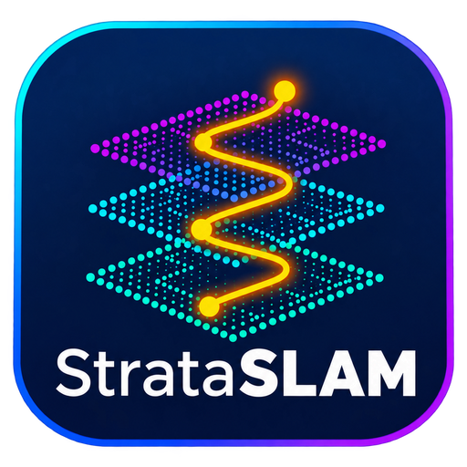

<p align="center">
  
</p>

<p align="center">
  <a href="https://github.com/EasyNavigation/StrataSLAM/actions/workflows/ci.yml"></a>
  <a href="https://github.com/EasyNavigation/StrataSLAM/actions/workflows/nightly.yml"></a>
  <a href="https://codecov.io/gh/EasyNavigation/StrataSLAM"></a>
  <a href="LICENSE"></a>
  <a href="docs/user/install.md"></a>
  
</p>

# StrataSLAM

Open multi-floor 3D SLAM for ROS 2: **one point cloud per floor and a global one, without the floors
collapsing into each other.** RGB-D camera, 3D LiDAR or both, or a 2D laser scanner on a ground robot; IMU,
barometer and external odometry are optional; everything is configured with one YAML profile. `strataslam doctor` checks your setup before you
map, and an offline tool fuses the floors, even without any visual overlap, in a gravity-aligned
4-degree-of-freedom group (SE(2)×ℝ).

Status: **v0.2.0**. Licensed under Apache-2.0; third-party dependencies are in [THIRD_PARTY.md](THIRD_PARTY.md).

## Why

When a robot changes floor (elevator, stairs, ramp, drone) current SLAM systems lose the height (an
elevator cabin moves with the sensor), close false loops between identical-looking floors, or reset the
origin in a dark stairwell. StrataSLAM keeps **one submap per floor** (no online code path accepts a loop
between two floors), detects and classifies each transition, and fuses the floors offline with the
transition constraints, the barometer, structural anchors and a weak floor-height prior.

## Quick start

```bash
# ROS 2 Jazzy, Ubuntu 24.04. The first build downloads small_gicp (pinned commit): it needs network.
mkdir -p ~/strataslam_ws/src && cd ~/strataslam_ws/src
git clone https://github.com/EasyNavigation/StrataSLAM.git strataslam && cd ..
source /opt/ros/jazzy/setup.bash
src/strataslam/scripts/install_deps.sh ros          # apt: GTSAM, Eigen, yaml-cpp, OpenCV, libpng, libjpeg, pybind11, GTest
colcon build --symlink-install --cmake-args -DCMAKE_BUILD_TYPE=Release && source install/setup.bash
```

No sensor at hand? [A first map, start to finish](docs/user/mapping.md#a-first-map-start-to-finish-simulated-building)
maps a simulated two-storey building from a rosbag the simulator writes.

## Running with ROS 2

Everything is configured by one YAML profile. Copy the template of your kind of robot and set its topics and frames
([profiles](docs/user/profiles.md)): `ground_camera`, `ground_lidar`, `ground_lidar_camera_imu`,
`handheld_camera_imu` or `aerial_lidar_camera_imu`.

```bash
P=$(ros2 pkg prefix strataslam_ros)/share/strataslam_ros/profiles
cp $P/ground_lidar.yaml ~/my_robot.yaml      # then edit topics and frames
```

**Mapping with a real robot.** With the robot's drivers running:

```bash
strataslam doctor ~/my_robot.yaml            # checks topics, rates, TF and sync against the profile
ros2 launch strataslam_ros strataslam.launch.py profile:=$HOME/my_robot.yaml viewer:=true
# drive the robot around, across floors if you like; then save the map (Ctrl+C saves it too):
ros2 service call /strataslam_node/save_map std_srvs/srv/Trigger
```

**From a recorded rosbag.** Record the topics of the profile with TF, then process the bag offline: every message
in order, none dropped, so a run repeats exactly (with `runtime: {threads: 1}` bit for bit). The map is saved when the
bag ends.

```bash
ros2 bag record -o my_run /points /tf /tf_static   # the profile's topics, here ground_lidar's
strataslam doctor ~/my_robot.yaml --bag my_run
ros2 launch strataslam_ros strataslam.launch.py profile:=$HOME/my_robot.yaml bag:=my_run viewer:=true
```

**With a navigation stack.** StrataSLAM publishes `map -> floor_<k> -> odom` (REP-105), so [Nav2](https://nav2.org) or
[EasyNav](https://github.com/EasyNavigation/EasyNavigation) and RViz see the robot in `map` while it maps. If
another localizer owns `map -> odom` (AMCL), set `output.publish_tf: false` in the profile
([TF](docs/user/mapping.md#reference)).

What the node publishes: `/strataslam/odometry`, `/strataslam/path`, `/strataslam/floor_state` (current floor and
transitions) and `/strataslam/floor_cloud` (the current floor's cloud, for RViz); services `~/save_map`,
`~/new_session` and `~/mark_floor_change`. `viewer:=true` needs `rerun-sdk`
([live view](docs/user/mapping.md)). Each run is saved under `~/strataslam_maps/<date>_<time>/`; afterwards:

```bash
strataslam fuse   ~/strataslam_maps/<run>        # the floors into one building (--anchors anchors.yaml if needed)
strataslam export ~/strataslam_maps/<run>        # one PCD per floor; --format ply for PLY
strataslam export ~/strataslam_maps/<run> --format grid   # an occupancy grid per floor for nav2 (PGM + YAML)
```

The user guide is in [docs/user/](docs/user/README.md); the on-disk map format in
[docs/data_format.md](docs/data_format.md); the design decisions (and the deviations from the plan, each with
its reason) in [docs/decisions.md](docs/decisions.md).

## Layout

| Directory | Contents |
| --- | --- |
| `strataslam_core/` | ROS-free C++ library: config, Pose4 and Lie-group math, frontends, place recognition, floor manager, backend, mapping, I/O, fusion, metrics |
| `strataslam_sim/` | synthetic multi-floor buildings (stairs, elevator, ramp, atrium), trajectories, sensors with exact ground truth, scenarios S01-S15, benchmarks |
| `strataslam_msgs/`, `strataslam_ros/` | messages/services, the node, launch file, example profiles, simulator-bag exporter |
| `strataslam_tools/` | Python: the `strataslam` command line, doctor, evaluation, export, fusion ablation |

## Build and test

Installation, for users and from a clean machine: [docs/user/install.md](docs/user/install.md). For development:

```bash
# Core and simulator, no ROS needed (scripts/install_deps.sh core installs the system packages):
cmake -S superbuild -B build -DCMAKE_BUILD_TYPE=Release && cmake --build build -j
ctest --test-dir build --output-on-failure -j4                 # unit tests + scenarios S01-S15 (seed 42)
python3 scripts/run_seeds.py --runner build/strataslam_sim/strataslam_scenario_runner --seeds 1001-1020   # 20 seeds
# Python (lint and types as in CI):
pip install -e "strataslam_tools[dev]"
ruff check . && (cd strataslam_tools && mypy strataslam_tools)
STRATASLAM_SAMPLE_BIN=build/strataslam_core/strataslam_write_sample_clouds STRATASLAM_EVAL_BIN=build/strataslam_core/strataslam_eval_tool pytest strataslam_tools/tests
python3 scripts/license_audit.py --ldd build/strataslam_core/libstrataslam_core.so && python3 scripts/check_links.py
# ROS 2, from a workspace with this repository in src/:
colcon build && colcon test
# The install guide itself, in clean Docker containers:
scripts/check_install.sh core && scripts/check_install.sh ros
```

Sanitizers: `-DSTRATASLAM_ENABLE_SANITIZERS=ON`. Coverage: `-DSTRATASLAM_ENABLE_COVERAGE=ON` then
`scripts/check_coverage.py`. Lint: `run-clang-tidy -p build` (`.clang-tidy`). Benchmarks:
`build/strataslam_sim/strataslam_benchmarks`.

## Results

[docs/results.md](docs/results.md): the fifteen synthetic scenarios on 20 seeds (pass rate, mean, deviation and worst
case of every criterion, each failure with its seed), a camera-noise study, the fusion ablation, TUM RGB-D fr1/fr2 and
a KITTI drive. [docs/scenarios.md](docs/scenarios.md) has the full report of every scenario on the CI seed. Both are
written by `scripts/make_results.sh` (ADR-0035). [docs/benchmarks.md](docs/benchmarks.md) keeps the history of the
real-data and performance figures, one row per measurement, taken from the same script's output.

## Citing

See [CITATION.cff](CITATION.cff).
