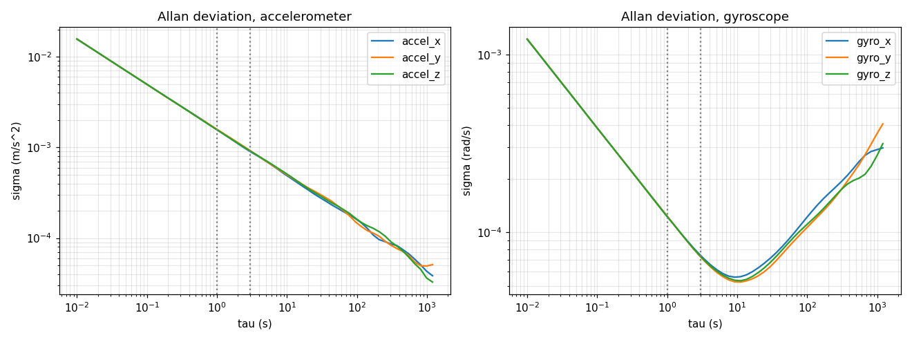

# Measuring the noise of an IMU (Allan deviation)

The `sensors.imu.noise` block of a profile (`accel_noise_density`, `gyro_noise_density`,
`accel_random_walk`, `gyro_random_walk`) is measured from a recording of the IMU at rest:

```bash
ros2 bag record -o imu_still /oak/imu                 # still for 2-3 h at least (6 h for the random walk)
strataslam imu-noise imu_still --topic /oak/imu --margin 2 --plot allan.png
```

Keep the sensor on a rigid surface, without vibration or air currents, and warm (leave it on for a while first). The
command prints the four values with their units, ready to paste:

```yaml
sensors:
  imu:
    noise:
      accel_noise_density: 3.169e-03   # m/s^2/sqrt(Hz)
      gyro_noise_density: 2.459e-04    # rad/s/sqrt(Hz)
      accel_random_walk: 9.891e-06     # m/s^3/sqrt(Hz)
      gyro_random_walk: 3.684e-05      # rad/s^2/sqrt(Hz)
```

## How it is read

The Allan deviation of each axis (`docs/media/allan_synthetic.png`, from a synthetic recording of known noise) shows
every noise as a slope on a log-log plot:

| Noise | Where | Slope |
| --- | --- | --- |
| White noise, density **N** | value at tau = 1 s | -1/2 |
| Random walk of the bias, **K** | the asymptote of the long taus, taken back to tau = 3 s | +1/2 |
| Bias instability | minimum of the curve | 0 |

Of the three axes the worst is kept, and `--margin` multiplies the result (a moving IMU is worse than a parked one;
2 to 3 is usual). The tool warns when:

- the recording lasts less than 2 h (the random walk and the bias instability are then not reliable);
- the curve does not reach tau = 3 s;
- an axis has no +1/2 slope at the long taus (the bias does not walk within the recording): its random walk is then
  an **upper bound**;
- the curve does not fall as 1/sqrt(tau) before 1 s (vibration, or a quantized sensor): N may be pessimistic.

Reading a rosbag2 needs ROS (`rosbag2_py`, source your workspace); the plot needs matplotlib.


